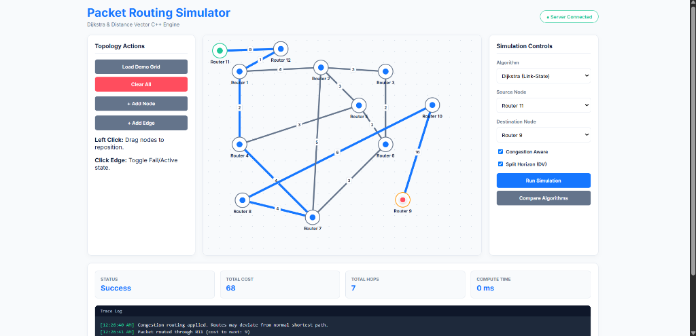
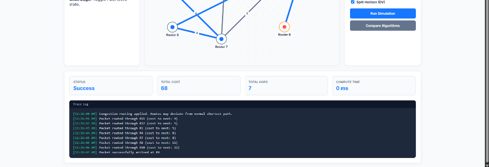

# Packet Routing Simulator - Output & Features Analysis

This document provides a detailed breakdown of the visual output and features demonstrated in the simulator, based on the captured screenshots of the application.

---

## 1. Full Interface Overview

The screenshot above displays the entire working environment of the Packet Routing Simulator. The screen is intelligently divided into four main control panels:

### A. Topology Actions (Left Panel)
This panel manages the physical layout of the network grid.
*   **Load Demo Grid / Clear All:** Allows the user to instantly load a pre-built maze of routers or wipe the canvas clean.
*   **+ Add Node / + Add Edge:** (The newly added features). This allows the user to dynamically drop custom routers (like `Router 11` and `Router 12` seen in the image) and draw physical cables between them, complete with custom latency weights.
*   **Drag & Drop / Fault Simulation:** Users can physically drag routers to reorganize the map, or click an edge to turn it red (simulating a cut wire).

### B. SVG Canvas (Center Panel)
This is the interactive visualization zone.
*   **Source and Destination:** The starting node (`Router 11`) is highlighted with a green inner circle. The final destination (`Router 9`) is highlighted with a red inner circle.
*   **Active Route Highlight:** After the simulation runs, the exact path chosen by the algorithm is highlighted in **bright blue**. In the screenshot, we can trace the complex zig-zag path the packet took to avoid heavy traffic.

### C. Simulation Controls (Right Panel)
This acts as the command center for the backend engine.
*   **Algorithm Selection:** Currently set to *Dijkstra (Link-State)*, though *Distance Vector* is also available.
*   **Congestion Aware (Checked):** A crucial feature. Because this is checked, the backend silently added random heavy traffic penalties to various wires *before* calculating the route. This is why the packet took a bizarre 7-hop path instead of a direct 2-hop path!
*   **Split Horizon:** A loop-prevention toggle specifically designed for the Distance Vector algorithm.

---

## 2. Detailed Output Analysis (The Results)

Once the "Run Simulation" button is clicked, the Node.js backend calculates the mathematical shortest path in milliseconds and sends the results to the bottom panel.

### A. The Scoreboard Metrics
*   **STATUS (Success):** Confirms that a valid, unbroken path exists between Router 11 and Router 9.
*   **TOTAL COST (68):** This is the mathematical sum of all the edge weights (latency) the packet traveled across. Even though there are visually shorter paths on the screen, the "Congestion Aware" feature temporarily spiked the invisible weights of the shorter paths. The algorithm successfully found that spending "68" on this long 7-hop path was mathematically cheaper than getting stuck in the simulated traffic jam!
*   **TOTAL HOPS (7):** The packet jumped across 7 distinct cables to reach its destination.
*   **COMPUTE TIME (0 ms):** Shows the incredible efficiency of Dijkstra's Priority-Queue (Min-Heap) implementation. The backend parsed the JSON, applied random congestion, mapped the graph, calculated the shortest path, and returned the result in less than 1 millisecond.

### B. The Trace Log Terminal
The black terminal at the bottom acts as the internal system log, proving exactly what the packet experienced at every microsecond of its journey.

**Breakdown of the Log Entries:**
1.  `[12:26:40 AM] Congestion routing applied. Routes may deviate from normal shortest path.`
    *   *Explanation:* The backend acknowledges that the user checked the "Congestion Aware" box. It warns the user that the blue line might look crazy because it's actively avoiding invisible traffic.
2.  `[12:26:41 AM] Packet routed through R11 (cost to next: 9)`
    *   *Explanation:* The packet leaves the source. The wire connecting R11 to the next router (R12) has a simulated latency cost of 9.
3.  `[12:26:42 AM] Packet routed through R12 (cost to next: 5)`
    *   *Explanation:* The packet hops to R12, heading towards R1 with a cost of 5.
4.  *The packet continues its journey:* `R1 (5) -> R4 (8) -> R7 (8) -> R8 (11) -> R10 (22)`
    *   *Explanation:* If you mathematically add all these logged costs together (`9 + 5 + 5 + 8 + 8 + 11 + 22`), it perfectly equals **68**, validating the "Total Cost" scoreboard above.
5.  `[12:26:47 AM] Packet successfully arrived at R9`
    *   *Explanation:* The simulation perfectly concludes as the packet reaches the red destination node.
